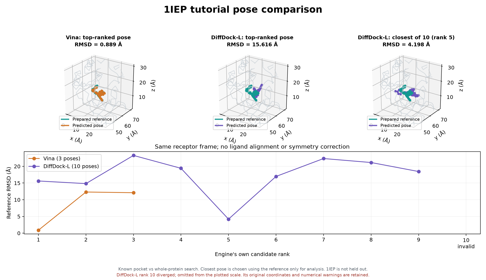

# Docking Agent 구현·실험 기록

> 도킹 도구를 연결하고 실제 결과까지 비교한 개발 기록.
> 차재민 · 개인 개발 결과 · 실행 2026-11-06 / 정리 2026-11-07

## 구현 요약

- **만든 것:** Codex가 호출할 `dock(request)` 함수와 CLI, 실행·검사·기록 경로.
- **실행한 것:** Windows에서 Vina·Vina-GPU·DiffDock-L을 같은 준비된 1IEP 구조로 실행.
- **발견한 것:** DiffDock-L은 성공 종료했지만 출력 10개 중 하나가 좌표 발산. 후속 CLI의 검사·경고 기록을 보완.
- 이번 단계의 대상은 **결합 자세 생성과 실행 관리**. 실험 친화도 예측 개선을 검증한 결과는 아님.

## 1. 구현 구조

### 개발 목적

- 에이전트가 도킹을 요청했을 때 입력과 실행 조건을 확인하고, 실제 엔진을 실행한 후 후보 자세·점수·로그를 되돌려주는 재사용 경로가 필요했음.

```text
Codex: 요청 해석 → 도구 호출 판단 → 결과 해석
  ├─ dock(request) / run.py
  │    ├─ Vina 1.2.7
  │    └─ Vina-GPU 2.1
  └─ diffdock_windows.py: 1IEP 검증용 별도 CLI
       └─ DiffDock-L
           ↓
후보 파일 · 엔진별 점수 · 입력 해시 · 설정 · 시간 · 로그
           ↓
파일·원자·좌표 확인 → 기본 기하 검사 → 참조 RMSD 비교
```

- Codex는 개발 세션에서 판단을 맡음. 독립 LLM API 앱은 아직 미구현.
- Vina·Vina-GPU는 공통 실행기로 연결. DiffDock-L은 공통 함수에 아직 통합하지 않음.
- 실행기는 요청 스키마·좌표계·박스·엔진별 옵션 검사, 제한 시간, 실행별 새 폴더와 결과 보존을 담당.
- ToolUniverse에 직접 의존하지 않음. 자동 엔진 선택·재시도·기권의 범용 정책은 미구현.

| 구현 파일 | 담당 기능 |
|---|---|
| `docking_agent/runner.py` | Vina 계열 공통 함수 `dock(request)` |
| `run.py` | JSON 요청을 받는 CLI |
| `diffdock_windows.py` | DiffDock-L의 준비된 1IEP 검증·실행 CLI |
| `docking_agent/geometry_sanity.py` | 기본 결합 길이 검사 |
| `compare.py`, `compare_diffdock.py` | 입력 대조·참조 RMSD·실행 결과 비교 |
| `scripts/`, `tests/` | Windows 준비·빌드, 실행기 오류 처리 검사 |

```python
from docking_agent import dock

result = dock(
    request,
    base_dir=request_path.parent,
    output_dir="outputs/1iep",
)
```

- request에는 수용체·리간드 경로, 같은 좌표계의 포켓 박스, 엔진·시드·탐색 옵션을 전달.
- 실행 폴더에 `request.json`, 입력 사본, 후보 묶음·개별 자세, `stdout.log`, `stderr.log`, `result.json` 보존.
- 구현 소스와 대용량 환경·가중치는 로컬 개발 폴더에 보존. 웹에는 설명과 실측 요약 게시.

## 2. 실험 설계

- 목적: Windows 실행 가능성과 결과 검사 경로 확인.
- 대상: 공식 Vina 튜토리얼의 준비된 1IEP 한 단백질–리간드 쌍.
- 단백질 중원자 2,229개: PDB와 PDBQT 좌표 모두 일치.
- 리간드 중원자 37개: SDF와 PDBQT 원자 대응 확인, 참조 좌표 오차 0 Å.
- RMSD는 같은 참조·단백질 좌표계에서 계산. 리간드 재정렬·대칭 보정 없음.

| 항목 | Vina CPU | Vina-GPU | DiffDock-L |
|---|---|---|---|
| 입력 | PDBQT + PDBQT | PDBQT + PDBQT | PDB + SDF |
| 탐색 위치 | 알려진 20 Å 포켓 박스 | 같은 포켓 박스 | 전체 단백질 |
| 탐색 옵션 | CPU 4, exhaustiveness 8 | thread 8000, RILC-BFGS 사용 | samples 10, 기본 schedule |
| 후보 요청 | 최대 5개 | 최대 5개 | 10개 |
| 시드 | 20261009 | 20261009 | 20261009 |

- 포켓 중심 `[15.19, 53.903, 16.917]`, 전체 변 길이 `[20, 20, 20] Å`.
- 탐색 위치·예산·후보 수가 다르므로 동일 조건의 성능 경쟁으로 해석할 수 없음.
- GPU: TITAN RTX. Vina-GPU는 VS 2019 C++ Build Tools, CUDA 12.1의 OpenCL SDK, Boost 1.77.0으로 고정 소스 빌드·장치용 커널 생성.
- DiffDock-L: Python 3.12.7, PyTorch 2.8.0+cu126, PyG 2.6.1, e3nn 0.5.1, ProDy 2.6.1. 소스 `85c49b60d3e0b0182a59ee43a34a6d7036981284`, v1.1 가중치.
- 원 논문과 동일 환경 재현을 뜻하지 않음. GNINA 비교는 보류.

### CPU·GPU가 달라지는 이유와 DiffDock-L의 차이

- CPU Vina 1.2.7과 Vina-GPU 2.1은 버전·탐색 구현·최적화 옵션이 다른 프로그램.
- 무작위 시작과 변화 경로, 계산량이 달라지면 생성 후보도 달라질 수 있음.
- 같은 시드 숫자는 서로 다른 엔진의 탐색 경로가 같다는 뜻이 아님.
- CPU exhaustiveness=8과 GPU thread=8000은 다른 설정. 이번 GPU에서는 RILC-BFGS를 켰음.
- Vina 계열: 시작 배치 → 위치·회전·비틀림 변경 → 도킹 에너지로 최적화 → 후보 정렬.
- DiffDock-L: 초기 배치 → 학습된 역확산 조정 → 여러 후보 생성 → 별도 confidence 모델로 정렬.
- 두 방법 모두 여러 후보를 만들지만 배치를 개선하고 정렬하는 규칙이 다름. 이번에는 포켓 정보 제공 여부도 달랐음.
- 이번 좌표 차이를 CPU·GPU의 수치 정밀도 하나로 설명하거나, DiffDock-L의 큰 오차 원인을 하나로 확정하지 않았음.

### 같은 움직임, 다른 결정 기준

- 두 방법 모두 화합물 전체의 이동, 전체 방향의 회전, 회전 가능한 결합을 축으로 하는 비틀림을 조정.
- Vina는 원자 종류·거리·겹침 등으로 도킹 점수를 계산하며 배치를 개선. 점수 변화 방향을 이용한 미세 조정, 무작위 변화와 여러 출발점을 사용.
- 배치 A(−4) → B(−7) → C(−9)는 원리 설명을 위한 가상 점수. 실제 측정값이 아님.
- DiffDock 사전 학습: 알려진 결합 자세 → 일부러 위치·회전·비틀림을 흐트러뜨림 → 조정 방향을 예측하도록 신경망 학습.
- DiffDock 실제 사용: 단백질 구조 + 초기 리간드 배치 → 학습된 생성 모델이 조정량 계산 → 배치 업데이트를 여러 단계 반복.
- 실제 모델 출력은 말로 된 지시가 아니라 이동·회전·비틀림 조정에 쓰는 수치. 새 문제의 정답 자세는 입력하지 않음.
- 여러 후보를 생성한 다음, 별도 confidence 평가 모델이 후보를 정렬. 후보 생성과 순위 결정은 분리.
- DiffDock-L은 이 기본 원리를 바탕으로 데이터·모델 규모 등을 확대한 버전. 이번 작업에서 모델을 새로 학습한 것은 아님.

## 3. 실행 결과

| 엔진 | 전체 실행 시간 | 출력 후보 | 1위 참조 RMSD | 후보 중 최소 RMSD |
|---|---:|---:|---:|---:|
| Vina CPU | 61.078초 | 3개 | 0.889 Å | 0.889 Å / 1위 |
| Vina-GPU | 4.844초 | 5개 | 0.892 Å | 0.892 Å / 1위 |
| DiffDock-L | 97.654초 / 캐시 재사용 | 10개 / 기하 실패 1개 포함 | 15.616 Å | 4.198 Å / 5위 |

- 시간은 함수·실행기 전체 경과 시간. 빌드·다운로드·GPU 커널 생성·DiffDock 최초 테이블 생성 제외.
- 이번 설정의 단건에서 GPU 함수 시간이 CPU보다 약 12.6배 짧았음. 같은 탐색량·반복 측정이 아니므로 일반적인 가속 배율을 뜻하지 않음.
- 두 Vina 계열의 최고 순위 자세는 참조 RMSD 약 0.89 Å.
- CPU·GPU의 1위끼리 직접 비교한 RMSD는 0.088385 Å. 중원자 37개, 같은 좌표계, 리간드 재정렬·대칭 보정 없음. 참조 대비 RMSD와는 다른 비교.
- DiffDock-L의 5위가 가장 가까웠다는 것은 **정답 참조를 이용한 사후 비교**. 모델이 정답 없이 5위를 채택했다는 뜻은 아님.
- Vina 1위 에너지 −13.270, Vina-GPU −13.3 kcal/mol. DiffDock-L 1위 confidence −3.30은 자세 순위 점수이며 확률·친화도가 아님.
- Vina 출력의 `rmsd_from_best`는 최고 예측 자세 기준임. 이 문서의 참조 RMSD는 준비된 튜토리얼 자세에 대해 별도 계산한 값.



- 청록색: 준비된 참조. 주황색: Vina. 보라색: DiffDock-L.
- 위쪽: 3D 좌표의 2D 투영. 아래쪽: 엔진별 자체 순위와 참조 RMSD.
- 발산 후보는 그래프 축에서 제외하고 invalid로 별도 표시. 원시 파일 보존.

### 최초 실행 비용

| DiffDock-L 실행 | 전체 시간 | 모듈·테이블 초기화 | 샘플링 |
|---|---:|---:|---:|
| 첫 실행 | 1,221.925초 | 1,156.210초 | 32.108초 |
| 캐시 재사용 | 97.654초 | 32.048초 | 32.585초 |

- 초기화·샘플링은 전체 시간의 일부. 첫 실행은 회전·비틀림 분포 테이블 생성 비용이 컸음.
- 캐시 이후에도 초기화·모델 로딩·ESM-2 임베딩·결과 처리 비용이 남음.
- 같은 시드의 두 실행에서 최고 순위 RMSD는 15.6162 Å와 15.6161 Å. 모든 후보가 비트 단위로 같지는 않았으며 두 실행 모두 발산 후보가 있었음.

## 4. 실패 분석

```text
종료 코드 0 / SDF 10개 / 유한한 좌표·원자·결합 목록
                    ↓
기본 결합 길이 검사: 이 유기 리간드에서 0.5–3 Å 범위
                    ↓
         9개 기본범위 내 / 1개 좌표 발산
```

- 재실행 로그에서 NaN 복구 관련 경고 15회 관찰. 추론 단계별 `1 / 10 samples failed` 반복이며, 서로 다른 후보 15개가 실패했다는 뜻은 아님.
- 10위 후보: RMSD 약 29,507,717 Å, 결합 길이 범위 0–9.90 Å.
- 파일 존재·파싱·유한한 숫자만으로 정상 자세로 볼 수 없었음.
- 원본과 로그 보존. 비교 그림에서 invalid 표시. 후속 CLI에 NaN 경고와 후보별 기본 기하 검사, 별도의 품질 경고 상태를 남기도록 보완.
- Windows 자체가 발산 원인이라는 결론은 내릴 수 없음.
- PoseBusters·단백질 충돌·정식 물리 타당성·실험 친화도 검증은 미수행. 9개 기본 검사 통과도 정답을 보장하지 않음.

## 5. 결론과 현재 범위

### 확보한 것

- 이 PC의 Windows에서 세 도킹 엔진 실행 경로.
- Vina 계열 공통 함수·CLI, DiffDock-L 별도 검증 경로.
- 같은 원자·좌표 기준으로 비교하는 실행 기록.
- 성공 종료 뒤 남은 수치 실패 탐지와 기록 보완.

### 아직 검증하지 않은 것

- 엔진들의 일반적인 성능 순위 및 신규 타겟·화합물에서의 정확도.
- 실험 친화도 예측의 개선과 보정·기권 성능.
- 범용 자동 엔진 선택·재시도·기권 정책.
- 팀 Orchestrator·다른 Agent와의 실제 연계.

**1IEP가 DiffDock 공식 학습 split 목록에 포함**되므로 미학습 일반화 예제로 해석할 수 없음.

연결할 위치: Structure Agent의 구조·좌표계·포켓 정보 → 이번 도킹 실행 경로 → Validation Agent의 물리·충돌 검사와 채택 판단. 전후 연결은 예정된 설계임.

확보한 것은 **실행 가능한 도킹 도구 연결과 결과를 검사할 기록**. Affinity 예측 향상 여부는 이후 별도 평가가 필요함.

## 상세 기록과 출처

- [실측 요약 JSON](assets/case-summary.json)
- [출처·파일 해시](source-manifest.json)
- [AutoDock Vina](https://github.com/ccsb-scripps/AutoDock-Vina)
- [공식 1IEP 튜토리얼](https://autodock-vina.readthedocs.io/en/latest/docking_basic.html)
- [Vina-GPU 고정 소스](https://github.com/DeltaGroupNJUPT/Vina-GPU-2.1/tree/180272b8a5265d6ed9664178345933cebe2cd349)
- [DiffDock 고정 소스](https://github.com/gcorso/DiffDock/tree/85c49b60d3e0b0182a59ee43a34a6d7036981284)
- [1IEP가 포함된 학습 목록](https://github.com/gcorso/DiffDock/blob/85c49b60d3e0b0182a59ee43a34a6d7036981284/data/splits/timesplit_no_lig_overlap_train)

개인 개발·실험 기록이며 공식 프로젝트 결과나 공식 평가 규약을 뜻하지 않음. 정적 웹페이지에서 모델·API를 호출하지 않음.

## 초보자용 용어 설명

웹에서 밑줄 용어를 누르면 읽는 법·쉬운 뜻·이번 실험의 의미를 볼 수 있습니다. [전체 용어 사전](glossary.md).
