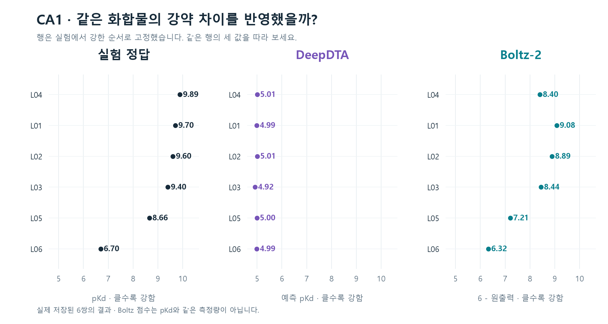
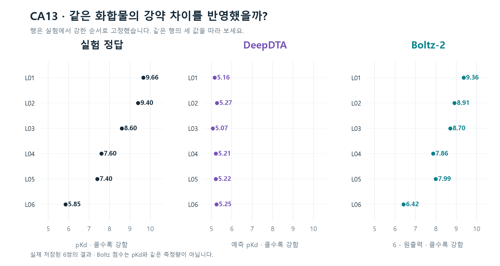

# DeepDTA와 Boltz-2, 결합 세기의 차이를 구분했을까?

CA1·CA13 × 같은 화합물 6개 = 12쌍. 개인 학습용 파일럿, 2026-11-19 정리.

## 한 문장으로 설명하기

이번 CA 사례에서는 Boltz-2가 같은 단백질 안에서 강한 화합물과 약한 화합물을 더 잘 구분했습니다. DeepDTA는 화합물이 달라도 예측값이 좁은 범위에 모였습니다. 두 타겟·목적 선정한 여섯 화합물의 결과로 일반적인 모델 우열을 확정할 수는 없습니다.

## 어떤 실험인가

- 이미 실험실에서 측정한 Kd를 정답으로 두고 두 사전학습 모델의 예측을 비교했습니다.
- CA1·CA13은 서로 다른 두 단백질입니다. L01–L06은 이번 비교의 화합물 번호입니다.
- 두 모델에 같은 12쌍을 각각 입력해 총 24개 예측을 얻었습니다. 추가 학습·보정은 하지 않았습니다.
- 두 타겟 공통 23화합물의 평균 실험 pKd 순서에서 1·5·10·14·19·23번째를 골랐습니다. 강도 범위를 넓게 보는 목적 표집이며 예측값은 선정에 사용하지 않았습니다.
- 실험 정답을 예측 입력에서 분리하고 예측 후 평가에 사용했습니다.

## 입력과 방식의 차이

| 항목 | DeepDTA | Boltz-2 |
|---|---|---|
| 입력 | 단백질 서열 + SMILES | 같은 서열·SMILES + MSA + Zn·접촉 조건 |
| 처리 | 각각 1D CNN 특징 추출 → 결합 → 회귀 | 복합체 3D 구조 생성 + 친화도 예측 |
| 출력 | pKd | 구조 CIF + 친화도 JSON |
| 표시 | pKd와 역변환한 예측 Kd | 6 − affinity_pred_value |
| 실행한 모델 | DeepPurpose CNN_CNN_DAVIS 재현 체크포인트 | Boltz 2.2.1 |

DeepDTA 원 논문의 TensorFlow 가중치와 구분합니다. DAVIS 키나아제 데이터로 학습한 공개 재현 모델입니다. Boltz의 원출력은 log10(IC50[μM]) 척도이며 6−원출력은 큰 값이 강한 방향으로 표시한 점수입니다. **실험 Kd로 환산한 값이 아닙니다.**

Zn은 단백질 A + 화합물 B + ZN 한 개 C로 설정했습니다. His95·His97·His120과 Zn의 최소 원자 접촉 거리를 4 Å 이내로 유도했습니다. 실험 구조 템플릿·리간드 자세·리간드–Zn 직접 제약은 제공하지 않았습니다. DeepDTA에는 명시적인 금속 입력이 없습니다.

## 12쌍 실제 결과

Kd는 작을수록 강하고 pKd와 표시 Boltz 점수는 클수록 강합니다.

| 사례 | 대상 | 화합물 | 실험 Kd(nM) | 실험 pKd | DeepDTA pKd | DeepDTA 예측 Kd(nM) | Boltz 점수 |
|---|---|---|---:|---:|---:|---:|---:|
| C01 | CA1 | L01 | 0.2 | 9.699 | 4.991 | 10,200 | 9.075 |
| C02 | CA13 | L01 | 0.22 | 9.658 | 5.160 | 6,923 | 9.357 |
| C03 | CA1 | L02 | 0.25 | 9.602 | 5.013 | 9,710 | 8.889 |
| C04 | CA13 | L02 | 0.4 | 9.398 | 5.273 | 5,331 | 8.911 |
| C05 | CA1 | L03 | 0.4 | 9.398 | 4.920 | 12,030 | 8.444 |
| C06 | CA13 | L03 | 2.5 | 8.602 | 5.069 | 8,526 | 8.701 |
| C07 | CA1 | L04 | 0.13 | 9.886 | 5.009 | 9,784 | 8.396 |
| C08 | CA13 | L04 | 25 | 7.602 | 5.214 | 6,106 | 7.862 |
| C09 | CA1 | L05 | 2.2 | 8.658 | 4.996 | 10,087 | 7.206 |
| C10 | CA13 | L05 | 40 | 7.398 | 5.216 | 6,087 | 7.993 |
| C11 | CA1 | L06 | 200 | 6.699 | 4.993 | 10,153 | 6.324 |
| C12 | CA13 | L06 | 1400 | 5.854 | 5.246 | 5,674 | 6.420 |

## 어떻게 해석하나

CA1에서 실제 L04 Kd는 0.13 nM, L06은 200 nM입니다. 약 1,538배 차이입니다. DeepDTA는 약 9,784 vs 10,153 nM로 거의 비슷하게 예측했습니다. Boltz는 8.40 vs 6.32로 강한 L04에 높은 점수를 주었습니다. Boltz 점수 차이를 실제 Kd 배율로 해석하지 않습니다.

| 단백질 | 모델 | 순위 상관(Spearman) | Kd 10배 이상 차이의 순서 정답 |
|---|---|---:|---:|
| CA1 | DeepDTA | 0.257 | 4/7 |
| CA1 | Boltz-2 | 0.657 | 7/7 |
| CA13 | DeepDTA | −0.314 | 4/12 |
| CA13 | Boltz-2 | 0.943 | 12/12 |

순위 상관은 +1이면 같은 순서, 0 부근이면 관계가 약하고 −1이면 반대입니다. 큰 차이 비교 총합은 DeepDTA 8/19, Boltz-2 19/19입니다. 같은 화합물을 반복 짝지은 파생 비교이지 19개의 독립 실험이나 일반적 정확도 100%가 아닙니다.

- DeepDTA의 실제 출력 폭은 CA1 약 0.09, CA13 약 0.20으로, 실험 pKd 범위 약 3.19·3.80에 비해 좁았습니다.
- Boltz도 CA1의 실험상 최강 L04 대신 L01을 1위로 골랐습니다. 가까운 강한 후보의 세부 순서까지 완벽하지 않습니다.
- 학습 데이터·입력·모델 방식이 함께 달라 ‘3D 구조 때문에 좋아졌다’는 원인 분리 실험은 아닙니다.
- 12/12의 간단한 Zn 거리 검사 통과는 기본 배치 확인입니다. 실험 자세 정확도나 친화도 정확도를 보장하지 않습니다.
- Boltz 학습 데이터 중복과 광범위한 타겟 일반화, 여러 seed 반복, 보정·기권 성능은 확인하지 않았습니다.
- 참고 단순 기준인 ‘분자량이 큰 순서’도 이 작은 표본에서 순위 상관 CA1 0.429, CA13 0.771입니다.

## 보조 관찰: 타겟 간 선호도

새 실험이 아니라 같은 결과의 다른 관점입니다. L05는 실험상 CA1 2.2 nM, CA13 40 nM인데 Boltz는 CA13에 더 높은 점수를 주었습니다(7.206 vs 7.993). 타겟 안의 순위와 타겟 간 선호도는 별도 능력입니다. 이번 중심 결론과 구분합니다.

## 출처와 재현

- [실험 Kd 원 논문](https://doi.org/10.1016/j.bmc.2013.01.008)
- [CA1 assay](https://www.ebi.ac.uk/chembl/explore/assay/CHEMBL2340479) / [CA13 assay](https://www.ebi.ac.uk/chembl/explore/assay/CHEMBL2340475)
- [DeepDTA 원 논문](https://arxiv.org/abs/1801.10193)
- [사용한 DeepPurpose 고정 소스](https://github.com/kexinhuang12345/DeepPurpose/tree/866be98bad0b11e78d4363589b9ee59b5befa307)
- [Boltz 2.2.1 입력·출력 문서](https://github.com/jwohlwend/boltz/blob/v2.2.1/docs/prediction.md)
- [12쌍 결과](data/results.csv) / [순위 평가](data/metrics.csv) / [실행 조건·파일 해시](data/reproducibility.json)

그림은 저장된 실제 수치, 화학 구조는 실제 SMILES를 사용했습니다. 처리 흐름은 설명용 도식입니다. 모델을 재실행하지 않고 자료만 재생성했습니다. 개인 학습 결과이며 공식 프로젝트 평가 규약이 아닙니다.
